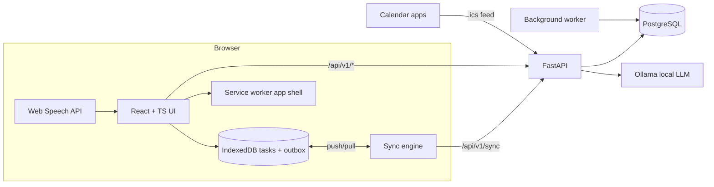

# LifeOS — Requirements & Architecture

## 1. Software Requirements Specification

### 1.1 Purpose
LifeOS is a personal productivity platform: one place to capture tasks, plan days/weeks/months,
track goals, get reminders and receive privacy-preserving AI assistance from a **local** LLM (Ollama).

### 1.2 Target users
Individuals (students, professionals, freelancers) who manage their own work across devices,
sometimes without connectivity, and who do not want their personal data sent to a cloud AI.

### 1.3 Functional requirements

| ID | Requirement | Implementation |
|---|---|---|
| F1 | Registration & authentication | Argon2id password hashes, opaque server-side sessions in `HttpOnly` cookies, CSRF token, rate-limited login |
| F2 | Tasks with priority, category, deadline, status | `tasks` table, REST + sync API |
| F3 | Daily / weekly / monthly planning | `scheduled_for` + `due_at`; `/planning` endpoint and offline client-side planner |
| F4 | Natural-language task creation | Rule-based parser (always available); optional Ollama segmentation of multi-task notes into verbatim pieces, each resolved by the rules; preview → confirm |
| F5 | AI productivity summaries | Deterministic stats + LLM narrative (template fallback) |
| F6 | Smart reminders & notifications | Background worker; per-task reminders, default lead time, daily digest in the user's local time |
| F7 | Calendar integration | Private, revocable iCalendar (`.ics`) subscription feed + `.ics` import with UID de-duplication |
| F8 | Goal tracking & progress analytics | `goals` table (manual metric or linked-task progress), analytics endpoint |
| F9 | Searchable activity history | `activity_logs` with text search, filters, pagination |
| F10 | Dark & light modes | System / light / dark, persisted per user |
| A1 | Local LLM (Ollama) | `services/llm.py`, configurable URL/model, timeouts, circuit breaker, graceful fallback; outputs validated (verbatim, coverage, number-fidelity guards) |
| A2 | Voice commands | Browser Web Speech API → `/ai/command` intent handler |
| A3 | AI task prioritisation | Explainable scoring (`services/prioritization.py`) + optional LLM focus note |
| A4 | Overdue & neglected tasks | `/ai/attention` |
| A5 | Personalised insights | `/ai/insights` derived from the user's own history |
| A6 | Offline access with sync | Service worker app shell, IndexedDB task store, outbox + versioned sync protocol |

### 1.4 Acceptance criteria → design
* **Tasks persist across restarts** — stored in PostgreSQL (SQLite in dev); covered by a test that
  disposes the engine and reconnects.
* **AI never creates duplicate tasks unintentionally** — (a) parsing is preview-only; (b) the direct
  create-from-text endpoint requires a `request_id` (idempotency key used as the task id) and checks
  open tasks with the same normalised title (`dedupe_key`); (c) duplicates inside one batch are
  collapsed; (d) calendar imports de-duplicate on the iCalendar `UID`.
* **Reminders respect time zones** — users store an IANA zone; all instants are stored in UTC; natural
  language ("tomorrow 9am") and the daily digest hour are interpreted in the user's zone (DST-aware via
  `zoneinfo`).
* **Offline changes sync without silent loss** — every task row has a `version`. Offline edits are
  queued with the version they were based on. A stale edit is **never** applied: the server returns a
  conflict with its copy and the UI asks the user to keep theirs or the server's. Operations are
  idempotent (`op_id`) so retries after a dropped connection are safe.
* **Export & delete data** — JSON (everything) / CSV (tasks) export; account deletion with password
  re-entry hard-deletes all rows via `ON DELETE CASCADE`.

### 1.5 Non-functional requirements
* Security: OWASP-aligned (see §6). Privacy: AI is local-only; no third-party telemetry.
* Performance: indexed queries per user, pagination on lists, keyset-style sync pages.
* Availability: works offline for task capture/planning; AI degrades gracefully when Ollama is down.
* Compatibility: evergreen Chrome, Edge, Firefox, Safari; 320 px → 1920 px viewports.
* Accessibility: WCAG 2.2 AA targets — semantic HTML, labels, focus rings, reduced motion.

### 1.6 Edge cases considered
Invalid/unknown time zones; DST gaps and overlaps; due dates without times; huge inputs (length caps
everywhere); duplicate submissions; concurrent edits on two devices; deletes racing edits; expired
sessions while offline (outbox survives re-login); Ollama timeouts or malformed JSON; malicious `.ics`
files (size limit, parse errors); CSV formula injection in exports; prompt injection via task titles
(LLM output is only ever validated data or display text — it cannot trigger actions).

## 2. Architecture



* **API** (`backend/app`) — FastAPI, synchronous SQLAlchemy 2 sessions in `def` endpoints (run in the
  threadpool, so the event loop is never blocked). Routers per domain; business logic in `services/`.
* **Worker** (`python -m app.worker`) — loop that dispatches reminders, daily digests and retention
  purges. Notification rows carry a unique `dedupe_key`, so running multiple workers cannot double-send.
  For single-process dev it can run inside the API (`RUN_WORKER_IN_API=true`).
* **Frontend** (`frontend/`) — Vite, React 19, TypeScript, Tailwind CSS v4, TanStack Query for online
  data, IndexedDB (`idb`) for the offline task store, `vite-plugin-pwa` for the service worker.
* **Deployment** — one image serves the API and the built SPA (same origin → simple cookies/CSRF);
  `docker-compose.yml` adds PostgreSQL, the worker and optionally Ollama.

## 3. Database schema

| Table | Key columns | Indexes / constraints |
|---|---|---|
| `users` | id (uuid), email, password_hash, display_name, timezone, theme, default_reminder_minutes, daily_digest_enabled, daily_digest_hour, last_digest_on, calendar_token_hash | unique(email), unique(calendar_token_hash) |
| `sessions` | id, user_id → users, token_hash, csrf_hash, expires_at, last_seen_at | unique(token_hash), idx(user_id) |
| `goals` | id, user_id, title, description, target_date, target_value, current_value, unit, status | idx(user_id, status) |
| `tasks` | id (client-generatable uuid), user_id, goal_id → goals (SET NULL), title, description, priority, category, status, due_at (UTC), due_has_time, scheduled_for (date), remind_at, reminder_sent_at, completed_at, estimated_minutes, source, dedupe_key, external_uid, version, deleted_at, created_at, updated_at | idx(user_id, updated_at), idx(user_id, dedupe_key), idx(remind_at) partial-ish, unique(user_id, external_uid) |
| `notifications` | id, user_id, task_id (SET NULL), kind, title, body, dedupe_key, read_at, created_at | unique(user_id, dedupe_key), idx(user_id, read_at) |
| `activity_logs` | id (bigint), user_id, action, entity_type, entity_id, summary, created_at | idx(user_id, created_at) |
| `sync_ops` | user_id, op_id, status, created_at | pk(user_id, op_id) |

All foreign keys to `users` use `ON DELETE CASCADE`. Migrations: Alembic (`backend/alembic`).

## 4. Sync protocol (tasks)

```
POST /api/v1/sync/push  {ops: [{op_id, kind: "upsert"|"delete", task_id, base_version|null, data}]}
  → results: [{op_id, status: applied|conflict|duplicate|rejected, task, error}]
GET  /api/v1/sync/pull?since=<cursor>&after=<page token>
  → {tasks (incl. tombstones), has_more, next, cursor, reset_required}
```
* `base_version = null` means "create"; it conflicts if the id already exists with different content.
* Otherwise the op applies only when `base_version == version`; the server bumps `version`.
* `delete` is a soft delete (tombstone `deleted_at`) so other devices learn about it; tombstones are
  purged after `TOMBSTONE_RETENTION_DAYS`, and a client whose cursor is older gets `reset_required`
  (full refresh, pending outbox preserved).
* Pull cursors overlap by 10 s to tolerate in-flight transactions; applying a pulled row is idempotent
  (client keeps the higher `version`).

## 5. API overview
Interactive OpenAPI docs: `/api/docs` (when `ENABLE_DOCS=true`). See [API.md](API.md).

## 6. Security design
Argon2id hashing · opaque 256-bit session tokens stored as SHA-256 hashes · `HttpOnly`, `SameSite=Lax`,
`Secure` (prod) cookies · CSRF header bound to session for unsafe methods · server-side ownership checks
on every query (`user_id = current user`) · SQLAlchemy parameterised queries · Pydantic validation with
length limits · restrictive CORS (explicit origins) · in-memory rate limiting on auth/AI/import ·
security headers (CSP, `X-Content-Type-Options`, `Referrer-Policy`, `X-Frame-Options`, HSTS in prod) ·
generic 500 responses (no stack traces) · logs never include passwords, tokens or task content ·
upload size caps · CSV formula-injection escaping · retention purges.

## 7. Development roadmap (as executed)
1. Backend core: config, models, migrations, auth. 2. Tasks, goals, planning, activity.
3. AI services (parser, LLM client, prioritisation, insights, summaries, commands).
4. Reminders worker, calendar, export/delete, sync. 5. Backend tests.
6. Frontend shell, auth, offline store/sync. 7. Pages. 8. Frontend tests + E2E. 9. Docker, CI, docs, QA.
